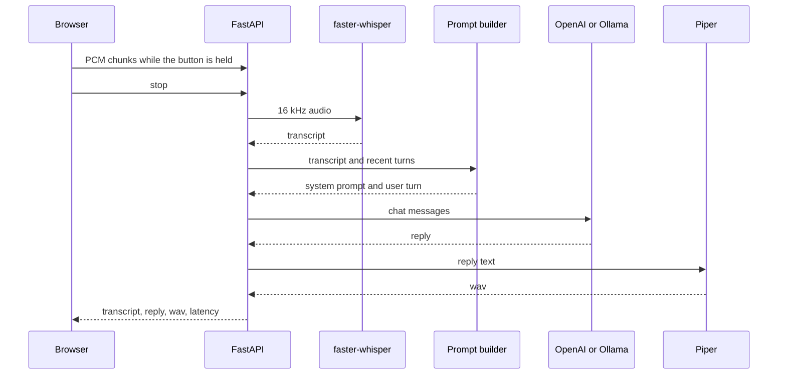

# VoiceDesk

VoiceDesk is a push-to-talk voice assistant. You hold a button in the browser, speak, and the server answers out loud.

The page streams microphone audio to a FastAPI service over a WebSocket. faster-whisper turns the audio into text. A prompt template, filled with the last few turns and an instruction for the detected intent, goes to the OpenAI API or to a local Ollama model. Piper speaks the reply. Every turn logs how long transcription, the model, and speech synthesis took.

The default configuration runs without API keys or downloaded models. Speech-to-text, the language model, and speech synthesis each have a local stand-in so the socket, the prompts, and the page can be tried on a laptop. Point the same code at faster-whisper, OpenAI or Ollama, and a Piper voice when you have them.

## Features

- Push-to-talk in the browser, with the space bar as well as the button
- Microphone audio streamed as 16 kHz PCM over a WebSocket
- Transcription with faster-whisper
- Prompt templates that carry a short conversation memory
- An intent route, and a fallback prompt when the request is unclear
- Replies from the OpenAI API or from Ollama
- Spoken replies with Piper
- A JSON latency line for each turn
- Docker Compose for the API and the web page

## Architecture



The browser captures the mic with an AudioWorklet, downsamples it to 16 kHz, and sends little-endian 16-bit samples. On release it sends a `stop` message. The server transcribes, chooses a template, calls the model, synthesizes a WAV, and sends that back on the same socket.

Intents the router knows: greeting, farewell, smalltalk, question, and task (reminders, timers, notes, translate, summarize). Anything else, or a match below the confidence threshold, uses the fallback template. That template tells the model to ask one clarifying question and not to guess. If the model call itself fails, the turn still finishes with a fixed spoken line.

## Folder structure

```
backend/app/
  api.py         WebSocket and HTTP routes
  pipeline.py    one turn: transcribe, prompt, model, speech
  prompts.py     templates, memory slot, fallback
  intent.py      ordered intent rules
  memory.py      bounded conversation window
  stt.py         faster-whisper and the local stand-in
  llm.py         OpenAI, Ollama, and the local stand-in
  tts.py         Piper and the local stand-in
  latency.py     per-turn timing log
frontend/src/    React push-to-talk page
docker-compose.yml
```

## Running locally

From the repository root:

```bash
python3 -m venv .venv
source .venv/bin/activate
pip install -r backend/requirements.txt -r backend/requirements-dev.txt
cp .env.example .env
PYTHONPATH=backend python -m uvicorn app.main:app --port 8000
```

In a second terminal:

```bash
cd frontend
npm install
npm run dev
```

Open http://127.0.0.1:5173 . The dev server proxies `/ws` to the API. Hold the button or the space bar, or type a line. With the defaults, any non-silent clip is transcribed as the phrase in `VOICEDESK_MOCK_TRANSCRIPT`, the mock model answers from the selected template, and playback is a short tone rather than speech. That path is only there so the rest of the turn can run with nothing installed.

Microphone capture needs a secure page. `localhost` is fine. A bare IP over plain HTTP usually is not.

### faster-whisper

```bash
# in .env
VOICEDESK_STT_BACKEND=whisper
VOICEDESK_WHISPER_MODEL=tiny
VOICEDESK_WHISPER_DEVICE=cpu
VOICEDESK_WHISPER_COMPUTE_TYPE=int8
```

The first request downloads the model into the Hugging Face cache. `tiny` is the practical choice on a CPU. `base` and `small` are the same code path with a different model name.

### OpenAI

```bash
VOICEDESK_LLM_BACKEND=openai
VOICEDESK_OPENAI_MODEL=gpt-4o-mini
VOICEDESK_OPENAI_API_KEY=sk-...
```

`VOICEDESK_OPENAI_BASE_URL` is optional, for a compatible endpoint. The key is read from the environment only. Do not commit `.env`.

### Ollama

```bash
ollama serve
ollama pull llama3.2
```

```bash
VOICEDESK_LLM_BACKEND=ollama
VOICEDESK_OLLAMA_BASE_URL=http://127.0.0.1:11434
VOICEDESK_OLLAMA_MODEL=llama3.2
```

### Piper

```bash
python -m piper.download_voices en_US-lessac-medium --download-dir models
```

```bash
VOICEDESK_TTS_BACKEND=piper
VOICEDESK_PIPER_MODEL_PATH=models/en_US-lessac-medium.onnx
```

That writes `en_US-lessac-medium.onnx` and a matching `.onnx.json`. The code loads them through `piper.PiperVoice`.

### Docker Compose

```bash
docker compose up --build
```

The web page is on http://localhost:8080 and the API is on http://localhost:8000 . Compose starts in mock mode. It reads the same variables from `.env` when that file exists.

To use Ollama inside Compose:

```bash
VOICEDESK_LLM_BACKEND=ollama docker compose --profile ollama up --build
docker compose exec ollama ollama pull llama3.2
```

A Piper voice checked out under `models/` is mounted at `/models` in the API container, so the in-container path is `/models/en_US-lessac-medium.onnx`. The Hugging Face cache is a named volume, which keeps the whisper model across restarts.

This is a local tool. If you expose it with a real OpenAI key, anyone who can open the socket spends that key.

## WebSocket protocol

Text frames are JSON. Binary frames are little-endian 16-bit mono PCM.

Client to server:

| Frame | Meaning |
| --- | --- |
| `{"type":"start","sample_rate":16000}` | Begin an utterance |
| binary | PCM samples while the button is held |
| `{"type":"stop"}` | End the utterance and run a turn |
| `{"type":"text","text":"..."}` | Skip the microphone and send text |
| `{"type":"reset"}` | Drop the conversation memory |

Server to client:

| Frame | Meaning |
| --- | --- |
| `ready` | Session id |
| `status` | `listening`, `transcribing`, `thinking`, or `speaking` |
| `transcript` | Recognized text, or the typed line |
| `reply` | Reply text, intent, and whether the fallback template was used |
| binary | WAV of the reply |
| `latency` | Stage timings for the turn |
| `empty` | The clip was too short or too quiet |
| `done` | The turn is finished |

Audio longer than 30 seconds is cut off. Sample rates other than 16 kHz are resampled on the server. The page always sends 16 kHz.

## Tests

```bash
cd backend
python -m pytest
python -m ruff check app tests
python -m ruff format --check app tests

cd ../frontend
npm test
npm run build

docker compose build
```

`make test`, `make lint`, and `make frontend` run the same checks. The pytest suite covers intent order, the fallback template, the memory window, a model outage, silence, the OpenAI and Ollama request shapes, the Piper WAV writer, and a full turn over the WebSocket. Provider tests do not download a whisper model or call a paid API. They check that the real clients are built and that the request those clients send is the one the code claims to send.

## Design decisions

The page sends PCM instead of a MediaRecorder blob. faster-whisper wants a waveform, and PCM keeps a decoder out of the turn. The worklet is connected through a gain of zero so the graph keeps running and the microphone is not played back into the room.

Memory is a window of turns rendered into the system prompt, not a second copy of the chat. The window is small because this is a spoken exchange. The intent for each stored turn is written next to the assistant line so the next prompt can see how the last reply was framed. Pronouns such as "tomorrow" only make sense with that block present, which is why a follow-up question still goes through the question template rather than starting over.

Intent is chosen before the model call. A task phrase wins over a question word, so "can you remind me" stays a task. Unclear speech does not get the question template with a low score. It gets a different instruction: ask one short clarifying question and do not guess. That is the intent fallback. A separate, fixed line is used only when the model request fails or comes back empty, so the speaker still hears something and the turn still logs a timing.

OpenAI and Ollama receive the same two messages, a system prompt and the current user turn. The mock model reads the system prompt too, which is why a local demo still follows the fallback template instead of inventing an answer.

Each turn writes one JSON object with `event` set to `turn_latency`. The fields are `stt_ms`, `llm_ms`, `tts_ms`, and `total_ms`, plus the intent and whether the fallback was used. The transcript is not in that line. The total includes the gaps between stages, so it can be a little larger than the three stage numbers added together. Set `VOICEDESK_LATENCY_LOG_PATH` to also append the same object to a JSONL file. The page shows the last turn's numbers. Those numbers are whatever that turn actually took. Nothing here is a benchmark.

The mock speech recognizer does not recognize speech. It returns one configured phrase for any clip that is long enough and loud enough. Silence and very short holds produce an empty turn and do not call the model. Swap `VOICEDESK_STT_BACKEND` to `whisper` when you want real transcription.
